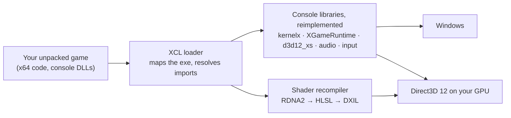

<p align="center">
  
</p>

<h1 align="center">XCL – modified build</h1>

<p align="center">
  <b>An installer and a handful of fixes on top of <a href="https://github.com/ivall/xcl">ivall/xcl</a>,<br>the Xbox Series X|S → Windows compatibility layer.</b>
</p>

<p align="center">
  <a href="https://github.com/theaustinayers/xcl/releases/latest"></a>
  
  
</p>

> **Unofficial.** This fork is not the XCL project and is not affiliated with it, with Microsoft
> or with any game publisher. All the hard work is upstream's. It contains **no game files,
> keys or shader caches** – you need your own unpacked game files.

## Why this build exists

Upstream XCL is built from source and started from a terminal. This fork packages it so that
someone can install it and point it at a game folder, and it carries a few fixes found while
bringing up a large game on an NVIDIA GPU.

| | Upstream | This build |
|---|---|---|
| **Getting it** | install Rust, the Windows SDK, build | one `XCL-Setup.exe`, per-user, no admin |
| **Shader compiler DLLs** | found in the Windows SDK | bundled next to `xcl.exe` |
| **Starting a game** | pick the exe / config, or `xcl run <folder>` | **Add a game folder…** in the launcher menu |
| **Mouse and window** | cursor pinned to the window while it is focused | cursor taken by a click in the picture, released by **F8**, the title bar or Alt+Tab – the window can be moved and resized |
| **Big shaders** | DXC compiles queue on the process heap lock | a heap per compile thread – very large programs compile in parallel |
| **Crash-reporter uploads** | set `XCL_NETWORK=0` yourself | installer option that sets it for you |

<p align="center">
  
</p>

## Honest status

XCL is a research project and this is a snapshot of it. Please read this before you try it.

- **What upstream reports as working** (see the table further down): a few retail titles are
  listed as playable. Those claims are upstream's; they were not re-tested with this build.
- **Large, new games: do not expect them to be playable.** With build 11 the game this build
  was tested against gets **through its menus, plays its intro video and shows its loading
  screen, and gets past it to the title card of its opening** on an RTX 5090. It stops there
  (the picture stands still, with wrong colours, and the game ends some seconds later):
  nothing playable has been reached. The video plays at about its real speed, with sound. Still open:
  the console's texture compression (BCPack) is decoded for BC1 only; pipelines that take the
  NVIDIA driver long to compile are skipped until they are ready; compute writes to depth
  buffers are lost.

- **Network:** XCL has no networking code of its own and does not phone home. The *game* does
  try to use the network – name lookups, and its crash reporter uploads a memory dump when it
  crashes. With the environment variable `XCL_NETWORK=0` XCL makes the game's web requests
  and outside socket connections fail (connections to the PC itself stay) and logs each attempt. The installer's "networking off" option (ticked by
  default) sets it for your account; by hand: `setx XCL_NETWORK 0`, then start XCL again.
- **NVIDIA GPUs are the slow path.** XCL is developed on AMD GPUs, which match the console.
  On NVIDIA the console's 64-lane programs are split in two and the driver's compiler takes
  seconds to minutes on each of the biggest ones. Results are cached, so each run gets further.

## Quick start

1. Download **`XCL-Setup.exe`** from the [latest release](https://github.com/theaustinayers/xcl/releases/latest) and run it.
2. Start **XCL** from the Start menu.
3. Choose **Add a game folder…** and pick the folder with the game's unpacked files
   (the one that holds `MicrosoftGame.config`).
4. Use a gamepad, or click inside the picture to play with keyboard and mouse (**F8** lets the mouse go).

Logs and per-game settings are in `%LOCALAPPDATA%\XCL\<title>\`.

### Requirements

- Windows 10 (22H2) or Windows 11, x64
- a Direct3D 12 GPU with Shader Model 6.6 and mesh shaders
- the Xbox **Gaming Services** component (`System32\xgameruntime.dll`)
- your own unpacked game files – XCL has nothing for decrypting packages

### Things you will run into

<details>
<summary><b>Windows Defender flags xcl.exe</b></summary>

The build is unsigned and XCL loads another program's code into itself and hooks system calls,
which is what heuristic ("!ml") detections look for. If you decide to trust it, add a folder
exclusion for the install folder. Build it from this source yourself if you would rather not
trust a binary.
</details>

<details>
<summary><b>The window stays black</b></summary>

The title bar says what XCL is doing (`compiling shaders: N running, M done, Q pipelines queued`).
First runs of a big game compile thousands of shaders. Leave it running: closing it throws away
the compile in progress, everything finished is cached. Whether a picture follows depends on
the game – see <a href="#honest-status">Honest status</a>.
</details>

<details>
<summary><b>The game uploads crash dumps</b></summary>

A game's own crash reporter may upload a memory dump of the process when it crashes. The
installer's "Run games with networking off" option sets `XCL_NETWORK=0`, which makes the game's
network calls fail as on a console without a network.
</details>

<details>
<summary><b>It runs my game's code – is that safe?</b></summary>

A game runs as native code inside XCL with no sandbox. Only run game files you trust.
</details>

## How it works



The game's CPU code is not emulated: the console is an x64 machine, so the code runs as it is
and XCL answers the console-only system calls, in the spirit of Wine / Proton. The console's
GPU programs are machine code for its AMD GPU and are recompiled into PC shaders.

## Building it yourself

```powershell
powershell -ExecutionPolicy Bypass -File build.ps1      # target\release\xcl.exe and dist\XCL-Setup.exe
```

Requirements and details are in [`BUILDING.md`](BUILDING.md). From build 6 on, the release
installer is built by GitHub Actions from the release's tag, with a public build log and a
provenance attestation – check a download with
`gh attestation verify XCL-Setup.exe -R theaustinayers/xcl`.

What changed against upstream is listed in [`installer/CHANGES.txt`](installer/CHANGES.txt).

## Licence and credits

**GPL-2.0-only**, as upstream ([`LICENSE`](LICENSE), [`THIRD_PARTY.md`](THIRD_PARTY.md)). XCL is
written by its upstream authors at <https://github.com/ivall/xcl>; please send compatibility
reports and thanks there. Product names are trademarks of their owners and are used only to
say what the software is compatible with.

---

# Upstream README

*Everything below is upstream's README, unchanged apart from one line about the launcher menu.*

## XCL – Xbox Series X|S → Windows compatibility layer

[](https://discord.gg/Tb4UbPUzRH)
**Discord: <https://discord.gg/Tb4UbPUzRH>**

XCL runs Xbox Series X|S (GDK) game files on a Windows PC **without CPU emulation**: the game's
x64 code runs natively and XCL stands in for the console libraries the PC does not have
(`kernelx.dll`, XGameRuntime, `d3d12_xs.dll`, …) – in the spirit of Wine/Proton. The console's
GPU code (RDNA2 machine code) is recompiled into PC shaders (HLSL → DXIL).

**Project state:** retail games run – Minecraft Preview and Unicorn Overlord are fully
playable, Fortnite and XDefiant work as far as each game goes without its online services;
see [Games](#games). The foundation is tested against real data from retail games
(shader packs, texture archives, movies and the console DLLs they ship). Details, measurements and
next steps:
[`HANDOFF.md`](HANDOFF.md); design: [`docs/specs/2026-11-20-xcl-design.md`](docs/specs/2026-11-20-xcl-design.md).

## Games

| Game | Package (version) | State | What works | Limits |
|---|---|---|---|---|
| **Minecraft Preview** | `Microsoft.MinecraftBeta` 1.18.3064.0 | ✅ | fully playable | – |
| **Unicorn Overlord** | `SEGAofAmericaInc.Pa253b0c1Y` 1.0.0.6 | ✅ | fully playable | – |
| **Fortnite** | `436609B6.FortniteClient` 2.0.1461.7919 | ✅ | works fully, as far as the game allows without its online services | the game itself is online-only (multiplayer servers) |
| **XDefiant** | `Ubisoft.XDefiant-Game` 1.0.0.186 | ✅ | works fully, as far as the game allows without its servers | the game's own servers have been shut down |
| **A newer retail game** | – | 🚧 | starts in ~4 s, runs at a steady 30 fps without a crash, shows its menus and goes on past the first one to its settings; fits a 32 GB machine (~15 GB committed in the menus) | gameplay not reached yet; its minimap mesh pipelines are refused |

## Highlights

- **100 % of a retail game's shaders translate** – all 26 698 RDNA2 programs (26 503 records) of its shader pack
  become HLSL; random samples compile to DXIL with 0 errors.
- **The game's own console DLLs run on the PC** – its Bink 2 video codec decodes the game's
  movies, its ray-tracing BVH builder builds acceleration structures on a PC GPU, the AMD FSR 4
  console upscaler runs a whole frame on a PC GPU, the GDK HTTP library initialises.
- **Console textures decode exactly** – the GFX10 tiling and mip layout reproduce 909 of 912
  textures of the game's texture archive byte for byte, its volume textures included.
- **370+ automated tests**, including GPU tests that compare translated shaders against expected
  results instruction by instruction.

## What works

✅ done and verified

### Running the game's code

| Feature | State | What it does | Verified by |
|---|---|---|---|
| **PE loader** | ✅ | relocations, imports by name / ordinal / delay-load, TLS callbacks, exception tables, game DLLs, data-driven import routing (HLE / Windows / stub) | the game's 16 console DLLs load with 0 unresolved imports |
| **kernelx** | ✅ | title memory (budget from MicrosoftGame.Config, physical pages), threads on the PC's processors, modules, OS / console info | unit + end-to-end tests |
| **Memory** | ✅ | title graphics memory shared by CPU and GPU without copies, up to 16 GB (4 GiB windows) | GPU tests: loads, stores and atomics across windows |
| **File system** | ✅ | console paths (`GAME:`, `G:`, `D:` …) → the game folder; writes go to an overlay, the game folder is never modified; the console's drives: `S:\` (persistent local storage) and `T:\` (temp) in the title's data folder; free disk space answered for console paths | end-to-end: the test title's folder stays byte-identical; PLS and free space through the real call path |

### System services

| Feature | State | What it does | Verified by |
|---|---|---|---|
| **XGameRuntime** | ✅ | the GDK thunk protocol real titles use, laid out from a table of all 396 GDK runtime functions; offline XUser, XGameSave, persistent local storage, XPackage, XGame (title id), XSystem – the title sees an Xbox Series X / S; task queues, async, networking and dialogs through the PC's XGameRuntime | the game's libHttpClient initialises; users, saves and storage through the real call path; slot layout cross-checked against the game's own thunks |
| **Input** | ✅ | GameInput: one gamepad – the PC's XInput controller, and keyboard and mouse as a gamepad (see [Controls](#controls)) | unit tests; an Xbox controller in Minecraft |
| **Audio** | ✅ | XAudio2 → system XAudio2.9 (PCM / float voices; Opus 0x704F decoded via `MSOpusDecoder.dll`; XMA1 / XMA2 decoded in pure Rust) | unit + end-to-end tests |

### Graphics

| Feature | State | What it does | Verified by |
|---|---|---|---|
| **Shader recompiler** | ✅ | RDNA2 → HLSL → DXIL: VS, PS, CS, mesh (NGG), GS; atomics, LDS, scratch, images, samplers incl. static ones, wave ops, ray-tracing instructions; structured control flow; parallel DXC, disk cache | 26 698 / 26 698 programs of the retail pack; 0 DXC errors on random samples; per-instruction GPU tests |
| **Pipelines** | ✅ | PSOs from console shaders: VS+PS, CS, MS+PS, VS+GS+PS; root signature with the shaders' static samplers; non-blocking creation – a pipeline whose shaders are not compiled yet gets a stand-in at once and is built in the background | GPU tests drawing the game's own VS / PS pairs, also built in the background |
| **D3D12.X compute** | ✅ | console device slots, console descriptor heaps (T# / V# / S#), buffers at their console addresses, compute command lists recorded in the console format and replayed (tables, barriers, clears, copies) | the game's BVH builder and FSR 4 record and run through XCL |
| **D3D12.X graphics** | ✅ | device, resources and heaps (also placed in title memory), pipelines; the title's graphics command lists – draws, indirect draws, graphics root arguments, barriers, copies, clears – and command lists recorded by console code, replayed; `PresentX` and frame pacing into an XCL window | Minecraft Preview plays its worlds (millions of draws, none skipped); Fortnite and XDefiant draw their screens |
| **Textures** | ✅ | GFX10 tiling (all 14 2D swizzle modes, the 6 3D thick modes, linear), mip chains with mip tail, arrays, cubes and 3D textures → PC textures | 909 / 912 retail textures exact (the 3 volume LUTs decode smooth); GPU upload bit exact |
| **Ray tracing** | ✅ | BLAS / TLAS built on the GPU by the game's own XboxBvhBuilder; RDNA2 BVH node format; BVH intersection instructions emulated in shaders | GPU traversal = brute force reference; the game's builder output checked on the GPU |
| **Upscaling** | ✅ | the game's AMD FSR 4 console DLL (`amd_fidelityfx_upscaler_xbox.dll`): context, the 29 pipelines in the console driver's own container (FSPX) translated, a frame's 20 passes recorded and run on the GPU | end-to-end with the real DLL: a 1280×720 → 1920×1080 frame on an RX 9070, the input's gradient in the output |

### Media and tools

| Feature | State | What it does | Verified by |
|---|---|---|---|
| **Video** | ✅ | the game's Bink 2 console DLL decodes its movies (720p / 1080p) on the CPU; the game's own YUV → RGB display shaders (`PS_Bink…` in its pack) translate like any other. Bink's GPU-assisted mode needs no Bink-specific support: its compute shaders ship with the game and go through the recompiler too (no game seen using it yet) | a game movie decodes frame by frame, picture checked |
| **Tools** | ✅ | `xcl inspect`, `xcl run`, `xcl disasm` (RDNA2, console shader containers), `xcl shaders` (pack statistics, recompile / compile runs), `xcl rpf` | – |

## Controls

A **gamepad is recommended**: console games are made for one, and their menus and controls expect it.

- **Gamepad:** any controller Windows sees through XInput (Xbox controllers, wired or wireless) is the
  game's gamepad – buttons, sticks, triggers and rumble. It can be plugged in or out while the game runs.
- **Keyboard and mouse** work too, as a gamepad: WASD the left stick, the mouse the right stick, mouse
  buttons the triggers, the wheel the bumpers, Enter / Space A, Escape / Backspace B, arrows the D-pad,
  E / Q Y / X, Shift / Ctrl the stick clicks, Tab View, P Menu. `keyboard_mouse` and `mouse_sensitivity` in
  the game's `xcl.toml` turn it off or change the mouse speed. A gamepad and the keyboard / mouse can be
  used together.

## Building and usage

Windows 10/11 x64, Rust (`stable-x86_64-pc-windows-msvc`), the Windows SDK (DXC: `dxcompiler.dll`
+ `dxil.dll`, looked up in `Windows Kits\10\bin\<version>\x64`, next to `xcl.exe` or in
`%XCL_DXC_DIR%`), a D3D12 GPU with Shader Model 6.6 and mesh shaders, and the system XGameRuntime
(`System32\xgameruntime.dll`, part of Windows / Gaming Services). On **Windows 10** (22H2
KB5029331+), inbox `D3D12Core.dll` stops at SM 6.5; place the Microsoft D3D12 Agility SDK
(`D3D12Core.dll`, plus `d3d12SDKLayers.dll` if using `XCL_D3D12_DEBUG=1`) in a `D3D12\` folder
next to `xcl.exe`, directly next to `xcl.exe`, in `%LOCALAPPDATA%\XCL\D3D12\`, or point `%XCL_D3D12_DIR%` at it
(for `cargo test`, use `%LOCALAPPDATA%\XCL\D3D12\` or `%XCL_D3D12_DIR%`).

- **DXC:** 1.8 or newer is recommended, from the
  [DirectXShaderCompiler releases](https://github.com/microsoft/DirectXShaderCompiler/releases): unpack one
  and point `XCL_DXC_DIR` at its `bin\x64`. A Windows SDK may hold an older one (the same `10.0.26100.0`
  folder has DXC 1.7.2308 or 1.8.2502, depending on the SDK's revision). DXC 1.7's DXIL was 2–2.7 times the
  size of 1.9's for translated compute programs and took an NVIDIA driver 1.4–2.2 times as long to build
  pipelines from ([#156](https://github.com/ivall/xcl/issues/156)). `xcl run` prints the DXC it loaded, and
  `report.json` has it under `dxc`.
- **GPU:** developed on AMD RDNA4. The console's geometry and NGG programs run as a compute pass plus a
  mesh pass, so a GPU without mesh shaders draws none of them. On GPUs with 32-lane waves only
  (NVIDIA) console wave64 compute, geometry and mesh programs run as two 32-lane halves that exchange
  masks and lane values ([`docs/wave64-on-wave32.md`](docs/wave64-on-wave32.md)) – slower than
  64-lane waves, most for groups of several waves; wave64 vertex and pixel shaders that read lanes 32–63
  can still differ there. Test results on other GPUs: [#42](https://github.com/ivall/xcl/issues/42).

```powershell
cargo build --release --workspace          # target\release\xcl.exe

xcl inspect D:\Game\game.exe               # the game's imports and what XCL has for them
xcl run D:\Game [-- game arguments]        # run
xcl disasm <shader.bin> [--hex]            # RDNA2 disassembler (console containers too)
xcl shaders D:\data\shaders.rpf --top 50   # pack statistics; --recomp / --compile N
xcl rpf D:\data\shaders.rpf --extract NAME --out folder
```

- **Without a command line** (xcl.exe opened from Explorer) XCL shows a small menu: *Add a game
  folder…* (pick the folder with the unpacked files), *Choose a
  game…* (pick its exe or `MicrosoftGame.config`) or *Run again* (the last one). On an error the
  window stays open until Enter.
- XCL works on **unpacked** game files you own; it contains nothing for decrypting or
  circumventing DRM.
- **The game folder is never modified** – writes go to the overlay.
- Every run writes `report.json` (called stubs, unknown D3D12.X slots and interfaces, XGameRuntime
  classes asked for, shader statistics, audio formats, crash).
  `d3d12.presents` counts presentations, not visible content. With `XCL_FRAME_DUMP=N` (`N > 1`),
  the existing optional frame dumps also set `d3d12.last_frame_dump`: the latest sampled frame's
  zero-based index, source dimensions, DXGI format, sample step, sample count and `non_dark_samples`
  (decoded 8-bit R+G+B > 30). The field is `null` until a frame is sampled; `non_dark_samples` is
  `null` if its format cannot be decoded. Intermediate render-target dumps do not update it.
  Sampling uses every fourth pixel in each direction (`XCL_FRAME_DUMP_FULL=1`: every pixel).
  A coarse sample can miss detail; a non-dark sample does not establish correct rendering or gameplay.
- `XCL_SHORT_MOVIES=1` (for test runs): a title's Bink videos end after their first frame – each
  goes to its last frame at its first step. A retail game's unskippable intro no longer takes its
  time in every run; nothing in the game's files changes.
- Title data: `%LOCALAPPDATA%\XCL\<title>\` (`%XCL_DATA_ROOT%`): `xcl.toml`, `overlay\`, `saves\`,
  `pls\` (the title's `S:\`), `temp\` (`T:\`), `cache\`, `logs\xcl.log`, `logs\report.json` (the
  previous run's: `xcl.prev.log`, `report.prev.json`).

## Tests

```powershell
.\scripts\test.ps1                         # cargo build --workspace + cargo test --workspace
```

Unit tests, an end-to-end test with our own "console title" (`tests/testtitle`) and GPU tests
(D3D12, SM 6.6; skipped without a GPU / DXC; `XCL_ADAPTER=1` or `XCL_ADAPTER=radeon` picks
another adapter than the first high-performance one, for titles too). A GPU test that cannot run on
the adapter (no GPU / DXC / wave64 / mesh shaders) passes too, but prints `SKIPPED <test>: <reason>`, and
`scripts/test.ps1` counts them at the end; `XCL_REQUIRE_GPU=wave64` (or `mesh`, or `wave64,mesh`) makes
those skips fail. Tests on real game data are opt-in through
environment variables pointing at your own files – `XCL_SAMPLE_RPF` (shader pack),
`XCL_SAMPLE_DLLS` (the game's console DLLs), `XCL_SAMPLE_TTPF` (texture archive),
`XCL_SAMPLE_BK2` (a movie), `XCL_SAMPLE_BVH4`, `XCL_SAMPLE_AWC` (a sound) – described in `HANDOFF.md`; without them those
tests pass without running anything (`scripts/test.ps1` lists the ones not set). No game data is
part of the repository.

## Licenses

**GPL-2.0-only** (`LICENSE`); third-party sources: `THIRD_PARTY.md` (including AMD's
machine-readable ISA, AMD addrlib swizzle patterns, LLVM disassembler tests, AnyPS5,
libHttpClient headers). WinDurango serves only as a reference – no code is ported from it. The
repository contains no headers or binaries from the console SDK.
